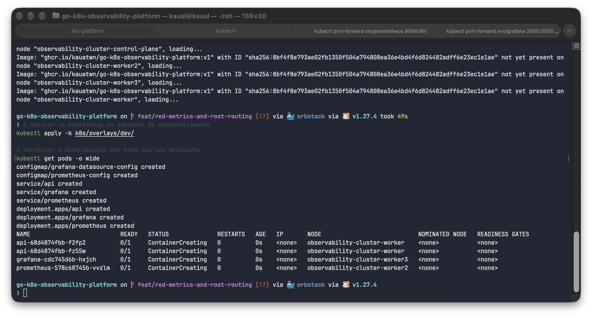
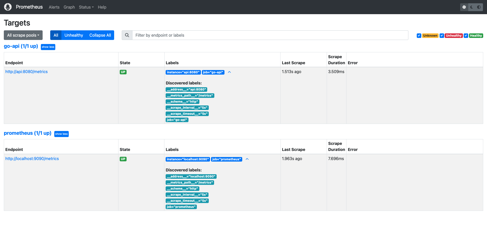
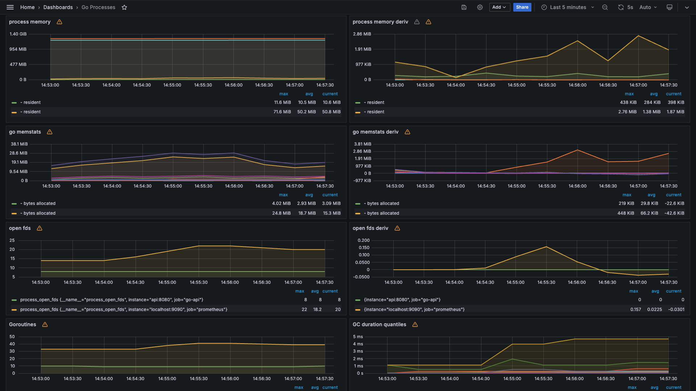

# Cloud-Native Go API & Kubernetes Observability Platform

[](https://github.com/kauatwn/go-k8s-observability-platform/actions/workflows/ci.yml)
[](https://github.com/kauatwn/go-k8s-observability-platform/actions/workflows/cd.yml)
[](https://golang.org/)
[](https://kubernetes.io/)
[](https://kustomize.io/)
[](https://prometheus.io/)
[](https://grafana.com/)

Plataforma *cloud-native* desenvolvida para demonstrar a criação, instrumentação, conteinerização segura e orquestração de uma API REST em Go dentro de um cluster Kubernetes multi-node (**Kind**), integrada a uma esteira automatizada de CI/CD via GitHub Actions, publicação no GitHub Container Registry (**GHCR**) e monitoramento com **Prometheus** e **Grafana**.

## Visão Geral & Objetivo

O objetivo deste repositório é servir como um **laboratório prático** de engenharia de software *cloud-native* e operação em Kubernetes. Em vez de focar em banco de dados ou regras de negócio complexas, a aplicação em Go atua como um serviço leve e resiliente para validar todo o ciclo de entrega, orquestração e monitoramento em cluster.

A API é instrumentada nativamente com o **Método RED** (*Rate, Errors, Duration*) para exportar métricas operacionais coletadas pelo **Prometheus** e visualizadas no **Grafana**. A implantação no cluster é gerenciada declarativamente pelo **Kustomize**, separando os recursos base dos overlays de ambiente (`dev` e `prod`).

### Principais Pilares Implementados

- **Desenvolvimento Go para Nuvem:** Servidor HTTP com *timeouts* estritos, *graceful shutdown* via sinais do sistema operacional (`SIGINT` e `SIGTERM`), logs estruturados em JSON (`log/slog`) e middleware de métricas RED.
- **Segurança em Contêineres:** *Multi-stage build* com binário estático (`CGO_ENABLED=0`), imagem base minimalista (*Distroless*), execução sob usuário não-root (`nonroot`) e sistema de arquivos somente leitura (`readOnlyRootFilesystem`).
- **Infraestrutura Declarativa com Kustomize:** Separação modular entre `k8s/base` e `k8s/overlays` (`dev` e `prod`) para evitar duplicação de manifestos e aplicar *patches* pontuais por ambiente.
- **Esteira Segura de CI/CD:** Workflows no GitHub Actions com *pinning* de Actions por Commit SHA, verificação de checksum SHA256 de binários, análise estática, varredura de vulnerabilidades (`govulncheck`), validação de schemas Kubernetes (`kubeconform`) e testes E2E em cluster Kind efêmero.
- **Observabilidade Nativa:** Coleta periódica de métricas via Prometheus e dashboards em tempo real no Grafana com *datasource* pré-provisionado.

## Arquitetura da Solução

```text
               +-------------------------------------------------------+
               |                  GitHub Repository                    |
               +---------------------------+---------------------------+
                                           |
                                 (Push / PR to main)
                                           |
                                           v
               +-------------------------------------------------------+
               |             GitHub Actions (ci.yml)                   |
               |  1. gofmt, go vet, go test & govulncheck              |
               |  2. Kubeconform & Kustomize Validation                |
               |  3. Static Binary Build & Docker Push (Commit SHA)    |
               +---------------------------+---------------------------+
                                           |
                                           v
               +-------------------------------------------------------+
               |          GHCR (GitHub Container Registry)             |
               |       ghcr.io/kauatwn/go-k8s-observability-platform   |
               +---------------------------+---------------------------+
                                           |
                             (workflow_run -> cd.yml)
                                           |
                                           v
+-----------------------------------------------------------------------------------+
|                           Kind Multi-Node K8s Cluster                             |
|                          (Cluster: observability-cluster)                         |
|                                                                                   |
|  [ Worker 1: app-worker ]                                                         |
|  +-----------------------------------+                                            |
|  |   API Pod (Port 8080)             |                                            |
|  |   - /{$}      (Home JSON)         |                                            |
|  |   - /healthz  (Liveness Probe)    |                                            |
|  |   - /ready    (Readiness Probe)   |                                            |
|  |   - /metrics  (Prometheus RED)    |                                            |
|  +-----------------+-----------------+                                            |
|                    ^                                                              |
|                    | Scrape a cada 5s (http://api:8080/metrics)                   |
|                    |                                                              |
|  [ Worker 2: prometheus-worker ]              [ Worker 3: grafana-worker ]        |
|  +-----------------------------------+        +--------------------------------+  |
|  |   Prometheus Pod (Port 9090)      |<-------|   Grafana Pod (Port 3000)      |  |
|  |   - Coleta métricas da API e      | Query  |   - Datasource Prometheus      |  |
|  |     auto-monitoramento            |        |     pré-configurado via YAML   |  |
|  +-----------------------------------+        +--------------------------------+  |
+-----------------------------------------------------------------------------------+
```

## Evidências de Execução

Capturas obtidas durante a execução local da stack no cluster Kind, validando o agendamento dos Pods por nó, a descoberta de alvos pelo Prometheus e a visualização das métricas no Grafana:

### Distribuição dos Pods nos Workers (`nodeSelector`)



### Targets Ativos no Prometheus



### Métricas e Runtime no Grafana (Dashboard 6671)



## Tecnologias e Decisões de Engenharia

### 1. Aplicação & Runtime (Go 1.27)

- **Resiliência HTTP:** Timeouts explícitos (`ReadHeaderTimeout: 2s`, `ReadTimeout: 5s`, `WriteTimeout: 10s`, `IdleTimeout: 120s`) para mitigar ataques como *Slowloris*, além de *graceful shutdown* com janela de 10 segundos para drenar conexões ativas.
- **Roteamento Exato:** Uso do padrão `"/{$}"` no `http.ServeMux` para restringir a rota raiz exclusivamente a `/` e garantir retorno `404 Not Found` para caminhos desconhecidos.
- **Health Probes Nativas:** Endpoints `/healthz` (*liveness probe*) e `/ready` (*readiness probe* controlada via `atomic.Bool` com simulação de 3 segundos de aquecimento).
- **Logs Estruturados:** Uso da biblioteca padrão `log/slog` emitindo eventos em formato JSON no `stdout` com método, rota, status HTTP, duração e IP de origem.
- **Instrumentação Prometheus (Método RED):**
  - `http_requests_total`: Contador segmentado por `path` (`r.Pattern`), `method` e `status` (taxa de requisições e erros).
  - `http_request_duration_seconds`: Histograma segmentado por `path` e `method` (latência das requisições em segundos).

### 2. Conteinerização & Segurança (Docker & Kubernetes)

- **Multi-Stage Build:** Compilação isolada em `golang:1.27-alpine` com `-trimpath -ldflags="-s -w"` e transferência exclusiva do binário estático para `gcr.io/distroless/static-debian12:nonroot`.
- **Hardening de Pod:** Execução sob `UID/GID 65532` (`runAsNonRoot: true`), `allowPrivilegeEscalation: false`, remoção de todas as *capabilities* (`drop: ["ALL"]`), `readOnlyRootFilesystem: true` e volume efêmero em memória (`emptyDir` com `medium: Memory` e limite de `64Mi`) montado em `/tmp`.
- **Rótulos OCI:** Metadados padronizados na imagem para rastreabilidade da origem e descrição do artefato.

### 3. Orquestração & Kustomize (Kubernetes)

- **`k8s/base/`:** Declaração dos recursos compartilhados (Deployment da API com 2 réplicas, Services `ClusterIP`, Prometheus `v2.51.2` com *scrape* a cada 5s e Grafana `10.4.2` com *datasource* provisionado via `ConfigMap`).
- **`k8s/overlays/dev/`:** Ambiente local e de validação no CD, sobrescrevendo a imagem genérica `api` para `ghcr.io/kauatwn/go-k8s-observability-platform`.
- **`k8s/overlays/prod/`:** Simulação de ambiente produtivo aplicando *patch* para escalar a API para 3 réplicas sem duplicar manifestos.
- **Isolamento de Nós (`nodeSelector`):** O manifesto `k8s/kind/cluster.yaml` provisiona 1 `control-plane` e 3 `workers` dedicados (`app-worker`, `prometheus-worker` e `grafana-worker`).

### 4. Esteira de CI/CD (GitHub Actions)

- **CI (`.github/workflows/ci.yml`):**
  - Checagem de formatação (`gofmt`), análise estática (`go vet`), testes unitários (`go test`) e varredura de vulnerabilidades (`govulncheck`).
  - Validação estrita dos manifestos base e dos overlays renderizados do Kustomize via `kubeconform`.
  - Build do binário estático e publicação da imagem Docker no GHCR taggeada com o **Commit SHA** imutável (`${{ github.sha }}`).
- **CD (`.github/workflows/cd.yml`):**
  - Executado automaticamente via `workflow_run` após a conclusão com sucesso do CI.
  - Valida o checksum SHA256 do binário do `kind`, sobe o cluster multi-node no *runner*, baixa a imagem imutável do GHCR, injeta a tag dinamicamente com `kustomize edit set image` e executa *smoke tests* E2E nos endpoints da API, Prometheus e Grafana.

## Estrutura do Repositório

```text
.
├── .github/
│   └── workflows/
│       ├── ci.yml                  # Lint, segurança, validação K8s, build e push GHCR
│       └── cd.yml                  # Provisionamento de cluster Kind e smoke tests E2E
├── cmd/
│   └── api/
│       └── main.go                 # Ponto de entrada, configuração do servidor e graceful shutdown
├── internal/
│   ├── api/
│   │   ├── health.go               # Handlers de /healthz e /ready
│   │   ├── home.go                 # Handler da rota raiz /
│   │   ├── middleware.go           # Middleware de métricas RED e logs estruturados
│   │   ├── server.go               # Configuração do roteador HTTP
│   │   └── *_test.go               # Testes unitários dos handlers, middleware e rotas
│   └── metrics/
│       ├── prometheus.go           # Coletores Prometheus (CounterVec e HistogramVec)
│       └── prometheus_test.go      # Testes unitários das métricas
├── k8s/
│   ├── base/
│   │   ├── app/                    # Deployment e Service da API Go
│   │   └── monitoring/
│   │       ├── grafana/            # Deployment, Service e Datasource do Grafana
│   │       └── prometheus/         # Deployment, Service e ConfigMap do Prometheus
│   ├── kind/
│   │   └── cluster.yaml            # Definição do cluster Kind multi-node (1 CP + 3 Workers)
│   └── overlays/
│       ├── dev/                    # Overlay de desenvolvimento (tag v1 / injeção dinâmica no CD)
│       └── prod/                   # Overlay de produção (patch de 3 réplicas)
├── Dockerfile                      # Multi-stage build seguro (Distroless nonroot)
├── go.mod                          # Módulo Go 1.27 e dependências
├── go.sum
└── README.md
```

## Como Executar Localmente

### Pré-requisitos

- [Docker Engine](https://docs.docker.com/get-docker/) em execução
- [Kind](https://kind.sigs.k8s.io/) instalado
- [kubectl](https://kubernetes.io/docs/tasks/tools/) instalado
- [Go 1.27+](https://go.dev/dl/) *(opcional, apenas para rodar os testes unitários localmente)*

### 1. Executar os Testes Unitários (Opcional)

```bash
go test -race -v ./...
```

### 2. Build da Imagem e Criação do Cluster Kind

```bash
# Compilar a imagem Docker com a tag esperada pelo overlay dev
docker build -t ghcr.io/kauatwn/go-k8s-observability-platform:v1 .

# Criar o cluster multi-node (1 control-plane + 3 workers)
kind create cluster --config k8s/kind/cluster.yaml

# Carregar a imagem local para dentro dos nós do Kind
kind load docker-image ghcr.io/kauatwn/go-k8s-observability-platform:v1 --name observability-cluster
```

### 3. Implantar a Stack com Kustomize

```bash
# Aplicar os manifestos do ambiente de desenvolvimento
kubectl apply -k k8s/overlays/dev/

# Verificar a distribuição dos Pods nos nós dedicados
kubectl get pods -o wide
```

*(Para inspecionar os manifestos renderizados do ambiente de produção simulado sem aplicá-los, execute `kubectl kustomize k8s/overlays/prod`.)*

### 4. Expor os Serviços Localmente (`port-forward`)

Abra terminais separados para encaminhar as portas locais para os serviços do cluster:

```bash
# Terminal 1: API Go
kubectl port-forward svc/api 8080:8080

# Terminal 2: Prometheus
kubectl port-forward svc/prometheus 9090:9090

# Terminal 3: Grafana
kubectl port-forward svc/grafana 3000:3000
```

| Serviço | URL Local | Descrição |
| :--- | :--- | :--- |
| **API (Home)** | `http://localhost:8080/` | Endpoint raiz da API Go (`200 OK`) |
| **API (Liveness)** | `http://localhost:8080/healthz` | Verifica se o processo está ativo |
| **API (Readiness)** | `http://localhost:8080/ready` | Verifica prontidão (`503` nos primeiros 3s, depois `200`) |
| **API (Metrics)** | `http://localhost:8080/metrics` | Métricas brutas expostas no formato Prometheus |
| **Prometheus** | `http://localhost:9090/targets` | Interface do Prometheus e status dos alvos (`go-api` e `prometheus`) |
| **Grafana** | `http://localhost:3000` | Interface visual (credenciais padrão: `admin` / `admin`) |

### 5. Explorar Métricas no Grafana

1. Acesse `http://localhost:3000` (usuário `admin`, senha `admin`). O Prometheus já está configurado automaticamente como *datasource* padrão.
2. **Métricas de Runtime do Go:** Vá em **Dashboards > New > Import**, informe o ID **`6671`** (dashboard da comunidade para aplicações Go) e selecione o *datasource* Prometheus para visualizar consumo de memória, CPU, *goroutines* e *Garbage Collector*.
3. **Métricas RED da API:** Acesse **Explore** (ou crie um painel) utilizando as consultas PromQL abaixo:
   - **Taxa de requisições por segundo (Rate):**

     ```promql
     sum(rate(http_requests_total[1m])) by (path, method, status)
     ```

   - **Taxa de erros HTTP 4xx/5xx (Errors):**

     ```promql
     sum(rate(http_requests_total{status=~"4..|5.."}[1m])) by (path, status)
     ```

   - **Latência no percentil 95 em segundos (Duration - p95):**

     ```promql
     histogram_quantile(0.95, sum(rate(http_request_duration_seconds_bucket[1m])) by (le, path))
     ```

### 6. Remover o Cluster

```bash
kind delete cluster --name observability-cluster
```
